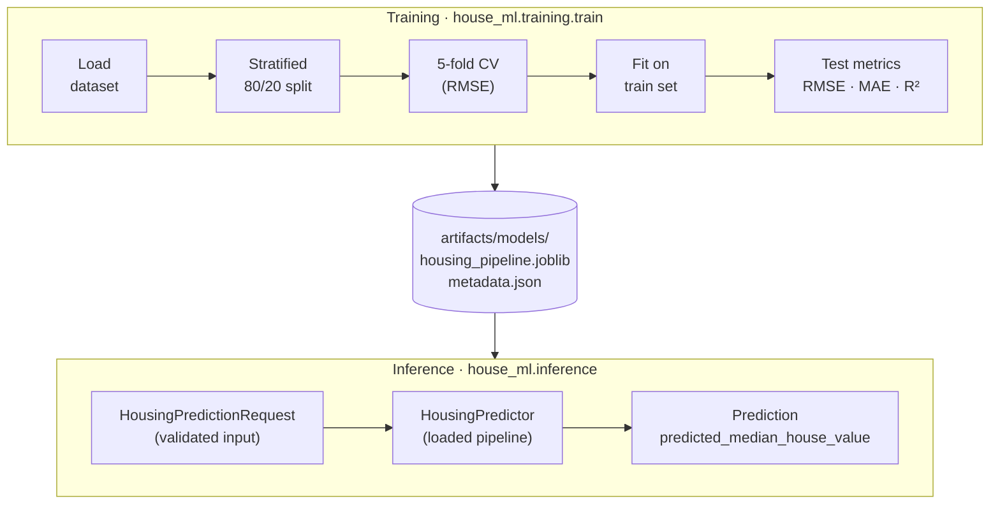

<div align="center">

# House Price ML

**A config-driven scikit-learn pipeline that predicts California median house values — from raw data to a persisted model and validated inference.**

[](https://github.com/Razuldev/house_price_ml_prod/actions/workflows/ci.yml)
[](pyproject.toml)
[](https://scikit-learn.org/)
[](https://python-poetry.org/)
[](https://docs.astral.sh/ruff/)
[](LICENSE)

</div>

`house_ml` trains a `RandomForestRegressor` on the public California Housing dataset to predict `median_house_value`, the median house value of a district. Data acquisition, stratified splitting, feature engineering, cross-validation, evaluation, and persistence live in an installable `src/` package driven by one YAML file, and prediction requests are validated by a Pydantic schema. Dependencies are locked with Poetry; pytest and Ruff run in GitHub Actions CI.

## Key capabilities

- **One config file**: data source, split, hyperparameters, cross-validation, artifact paths, and log level come from [`configs/config.yaml`](configs/config.yaml), parsed into frozen dataclasses.
- **Stratified hold-out split**: an 80/20 split stratified on five `median_income` bins preserves income-category proportions in both sets.
- **In-pipeline preprocessing**: ratio features, `log1p` transforms, imputation, scaling, and one-hot encoding live inside one scikit-learn `Pipeline`, so they are refitted per CV fold and saved together with the model.
- **Two-stage evaluation**: 5-fold cross-validated RMSE on the training set, then RMSE, MAE, and R² on the test set; NaN or infinite predictions raise an error.
- **Traceable artifacts**: the fitted pipeline is saved with joblib next to a `metadata.json` that records metrics, a UTC timestamp, the Git commit, and the Python and scikit-learn versions.
- **Validated inference**: `HousingPredictor` scores single records checked against numeric ranges and an allowed set of `ocean_proximity` values.

## Architecture



The persisted artifact is the complete `Pipeline`: a `ColumnTransformer` followed by the `RandomForestRegressor`.

| Branch | Inputs | Steps |
| --- | --- | --- |
| Ratios | `total_bedrooms / total_rooms`, `total_rooms / households`, `population / households` | median impute → ratio (zero denominator → 0) → scale |
| Log | `total_bedrooms`, `total_rooms`, `population`, `households`, `median_income` | median impute → `log1p` → scale |
| Categorical | `ocean_proximity` | most-frequent impute → one-hot (unknown → all zeros) |
| Remainder | `longitude`, `latitude`, `housing_median_age` | median impute → scale |

## Tech stack

| Area | Tools |
| --- | --- |
| Runtime and packaging | Python 3.12+, Poetry 2.2+ with `poetry.lock`, `src/` layout |
| Data and ML | pandas, NumPy, scikit-learn, joblib |
| Configuration and validation | PyYAML, dataclasses, Pydantic v2 |
| Quality and CI | pytest, Ruff, GitHub Actions |

## Project structure

```text
house_price_ml_prod/
├── .github/workflows/ci.yml   # Ruff lint, Ruff format check, pytest
├── configs/config.yaml        # Data, split, model, evaluation, artifact and logging settings
├── src/house_ml/
│   ├── config.py              # YAML → frozen dataclasses (AppConfig)
│   ├── data/                  # Download, load, stratified split, features/target split
│   ├── features/              # ColumnTransformer preprocessing
│   ├── models/                # Model factory and full Pipeline
│   ├── evaluation/            # Cross-validation and regression metrics
│   ├── training/train.py      # Training entry point
│   ├── artifacts/model_io.py  # Model and metadata persistence
│   └── inference/             # Schemas, HousingPredictor, demo runner
├── tests/
│   ├── unit/                  # Config, dataset, preprocessing, metrics, schema
│   └── integration/           # Pipeline smoke test, predictor round-trip
├── pyproject.toml             # Metadata, dependencies, Ruff and pytest settings
└── poetry.lock                # Locked dependency versions
```

## Getting started

**Prerequisites:** Python 3.12+, [Poetry](https://python-poetry.org/docs/#installation) 2.2+ (required for the PEP 735 `[dependency-groups]` table), and Git.

```bash
git clone https://github.com/Razuldev/house_price_ml_prod.git
cd house_price_ml_prod
poetry install
```

`poetry install` creates a dedicated virtual environment and installs the locked runtime dependencies, the `dev` group (pytest, Ruff), and `house_ml` itself in editable mode. Run project commands through `poetry run` so they use that environment. If Poetry reports an incompatible Python version, point it at a 3.12+ interpreter with `poetry env use <path-to-python>`. These commands work unchanged in PowerShell, Command Prompt, and POSIX shells.

## Configuration and data

[`configs/config.yaml`](configs/config.yaml) is read by `house_ml.config.load_config()`. Relative paths resolve against the repository root, not the working directory, and the entry points take no command-line arguments, so edit this file to change a run.

| Key | Default | Purpose |
| --- | --- | --- |
| `data` | `housing.tgz` from [ageron/data](https://github.com/ageron/data) | Dataset archive, cached in `datasets/` |
| `target.column` | `median_house_value` | Regression target |
| `split` | 20% test, `random_state: 42`, income bins at 1.5 / 3 / 4.5 / 6 | Stratified hold-out split |
| `model` | `random_forest`: 100 trees, `random_state: 42`, `n_jobs: -1` | Estimator; `random_forest` is the only implemented type |
| `evaluation` | 5 folds, `neg_root_mean_squared_error` | Cross-validation |
| `artifacts` | `artifacts/models/` | Model and metadata output |
| `logging.level` | `INFO` | Log verbosity |

### Dataset

Training uses the public California Housing dataset: one row per district with location, housing, population, and income features, the categorical `ocean_proximity`, and the `median_house_value` target. The data is not committed; `datasets/` is git-ignored.

> [!IMPORTANT]
> The built-in download step currently fails on a fresh clone (see [Known limitations](#known-limitations)). Fetch and extract the archive once, from the repository root, before the first training run.

```bash
mkdir datasets
curl -L -o datasets/housing.tgz https://github.com/ageron/data/raw/main/housing.tgz
tar -xzf datasets/housing.tgz -C datasets
```

On Windows, use `curl.exe` instead of `curl` (in Windows PowerShell, `curl` is an alias for `Invoke-WebRequest`); `curl.exe` and `tar` ship with Windows 10 (1803+) and Windows 11. This creates `datasets/housing/housing.csv`, and the pipeline then skips its own download and extraction.

## Training and evaluation

```bash
poetry run python -m house_ml.training.train
```

The run loads `datasets/housing/housing.csv`, makes the stratified split, cross-validates the full pipeline on the training set, refits it on all training rows, scores the test set, and writes the artifacts to `artifacts/models/`, logging each stage.

| Metric | `metadata.json` key | Evaluated on |
| --- | --- | --- |
| RMSE (mean, std) | `cv_rmse_mean`, `cv_rmse_std` | 5 CV folds of the training set |
| RMSE | `rmse` | Test set |
| MAE | `mae` | Test set |
| R² | `r2` | Test set |

No reference scores are published here; the values come from your own run.

## Inference

> [!NOTE]
> Inference loads `artifacts/models/housing_pipeline.joblib`, so train first. Without it, the predictor raises `FileNotFoundError: Model artifact not found`.

```bash
poetry run python -m house_ml.inference.run
```

The demo runner scores one hard-coded sample from [`run.py`](src/house_ml/inference/run.py) and prints a dict with a single key, `predicted_median_house_value`. To score your own records, use the Python API (for example in `poetry run python`):

```python
from house_ml.config import load_config
from house_ml.inference.predictor import HousingPredictor
from house_ml.inference.schemas import HousingPredictionRequest

predictor = HousingPredictor.from_config(load_config())
request = HousingPredictionRequest(
    longitude=-122.23, latitude=37.88, housing_median_age=41,
    total_rooms=880, total_bedrooms=129, population=322,
    households=126, median_income=8.3252, ocean_proximity="NEAR BAY",
)
print(predictor.predict(request).predicted_median_house_value)
```

`HousingPredictionRequest` takes float fields plus one category; invalid input raises `pydantic.ValidationError`.

| Field | Rule |
| --- | --- |
| `longitude` | `-180 ≤ x ≤ 180` |
| `latitude` | `-90 ≤ x ≤ 90` |
| `housing_median_age`, `total_bedrooms`, `population`, `median_income` | `≥ 0` |
| `total_rooms`, `households` | `> 0` |
| `ocean_proximity` | `1<H OCEAN`, `INLAND`, `ISLAND`, `NEAR BAY`, `NEAR OCEAN` |

The response, `HousingPredictionResponse`, has one float field: `predicted_median_house_value`. The repository contains no REST API or deployment configuration.

## Testing and code quality

```bash
poetry run pytest
poetry run ruff check .
poetry run ruff format --check .
```

- **Unit** (`tests/unit`): config loading, features/target split, ratio feature, metrics, and request validation.
- **Integration** (`tests/integration`): fits the full pipeline on a small synthetic frame and round-trips a joblib artifact through `HousingPredictor`.

Tests build their own in-memory data, so they need neither the dataset nor a trained model. Ruff applies the `E`, `F`, `I`, and `B` rule sets with an 88-character line length. The [CI workflow](.github/workflows/ci.yml) runs the same three checks on Python 3.12 (Ubuntu) for pushes and pull requests to `main` and `develop`.

## Artifacts and reproducibility

Training writes two files to `artifacts/models/`:

- `housing_pipeline.joblib`: the fitted preprocessing + model pipeline, loaded as-is by `HousingPredictor`.
- `metadata.json`: `created_at` (UTC, ISO 8601), `git_commit` (`null` without Git), `python_version`, `sklearn_version`, and `metrics`.

Fixed seeds for the split and the forest, together with the committed `poetry.lock`, make runs repeatable for the same data and dependency versions. scikit-learn does not guarantee that pickled models load across versions, so compare `sklearn_version` before reusing an artifact elsewhere. `datasets/`, `artifacts/models/`, `*.joblib`, and `.venv/` are git-ignored, so neither data nor trained models enter version control.

## Known limitations

- **Dataset bootstrap:** `download_dataset()` creates the parent of `datasets/` rather than the folder itself, so the first download fails with `FileNotFoundError`. The archive is also extracted into `datasets/housing/`, producing `datasets/housing/housing/housing.csv` instead of the path the loader reads. The manual fetch under [Dataset](#dataset) avoids both.
- **`ocean_proximity` label:** the schema accepts `1<H OCEAN`, but the dataset category is `<1H OCEAN`. Requests with the dataset value fail validation, and `1<H OCEAN` reaches the model as an unseen category (an all-zero one-hot vector).

## License

Released under the [MIT License](LICENSE).
